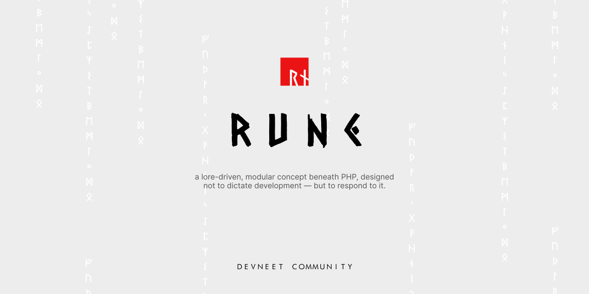

[← Back to Design Gallery](../README.md)

# mreazenith

## Exura

<table>
  <tr>
    <td align="center">
       
      V1 Card 1 Inverse
    </td>
    <td align="center">
       
      V1 Card 1
    </td>
    <td align="center">
       
      V1 Card 2 Inverse
    </td>
  </tr>
  <tr>
    <td align="center">
       
      V1 Card 2
    </td>
    <td align="center">
       
      V1 Logo Inverse
    </td>
    <td align="center">
       
      V1 Logo Title Inverse
    </td>
  </tr>
  <tr>
    <td align="center">
       
      V1 Logo Title
    </td>
    <td align="center">
       
      V1 Logo
    </td>
    <td align="center">
       
      V1 Title Inverse
    </td>
  </tr>
  <tr>
    <td align="center">
       
      V1 Title
    </td>
  </tr>
</table>

## Rune

<table>
  <tr>
    <td align="center">
       
      V2 Banner
    </td>
    <td align="center">
       
      V2 Card 1
    </td>
    <td align="center">
       
      V2 Card 2
    </td>
  </tr>
  <tr>
    <td align="center">
       
      V2 Logo Title White
    </td>
    <td align="center">
       
      V2 Logo Title
    </td>
    <td align="center">
       
      V2 Logo
    </td>
  </tr>
  <tr>
    <td align="center">
       
      V2 Title White
    </td>
    <td align="center">
       
      V2 Title
    </td>
  </tr>
</table>
